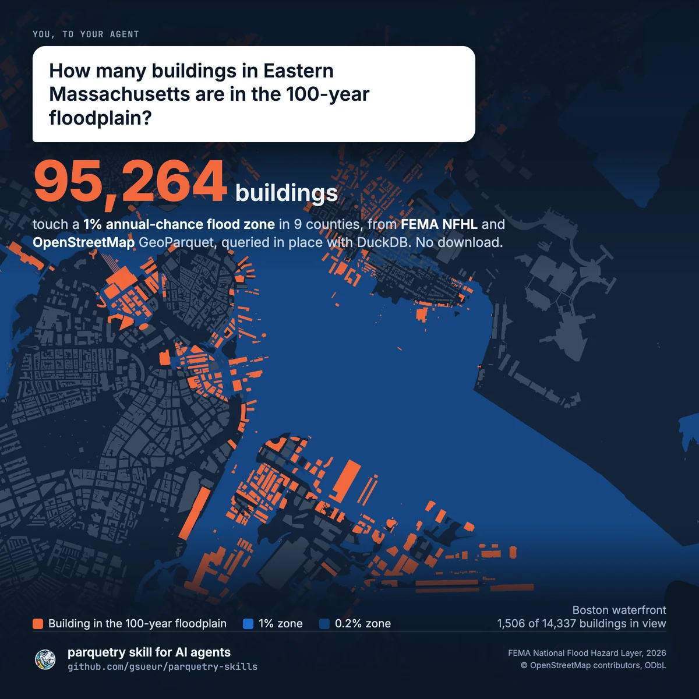
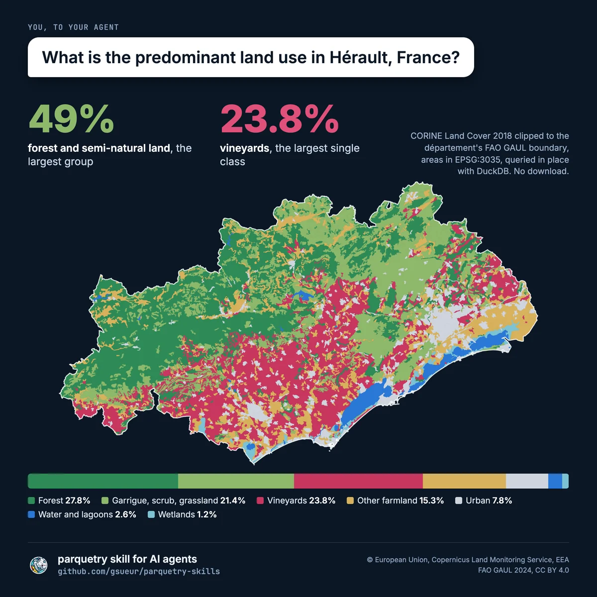

# parquetry skills

Two skills for AI agents working with GeoParquet:

- **`reference-data`** answers spatial questions with real reference data.
- **`write-geoparquet`** writes optimized GeoParquet the way these datasets
  are written (see [below](#writing-geoparquet)).

<p>
  <a href="docs/agent-boston-1200.webp"></a>
  <a href="docs/agent-herault-1200.webp"></a>
</p>

Two answers the skill gave, mapped from the same files: 95,264 buildings in
Eastern Massachusetts touch a 100-year flood zone (FEMA NFHL and
OpenStreetMap, Boston waterfront shown), and Hérault is 49% forest and
semi-natural land while vineyards are its largest single class (CORINE Land
Cover 2018 clipped to FAO GAUL).

## Answering spatial questions

The `reference-data` skill lets an agent answer questions with real data,
not general knowledge:

- *What is the predominant land use in Hérault, France?*
- *How many buildings could be hit by a 100-year flood in Eastern Massachusetts?*
- *How many km of 380 kV line cross Lombardy?*
- *Which substations are within 5 km of this site?*
- *Add the country, district and flood zone to my list of 300 sites.*
- *Which dams are on the Colorado River and its tributaries?*
- *Which congressional and state legislative districts do I vote in?*
- *How many people live within 5 km of my sites, and what do they earn?*
- *Which natural hazards threaten this site most?*
- *Is this site on protected land, and who manages it?*
- *Geocode these addresses and tell me which are in the flood zone.*

The agent turns the question into a spatial query over eighteen open datasets
published by Geomermaids on [parquetry](https://geoparquet.geomermaids.com),
runs it with DuckDB straight from the URLs, and answers with the number,
the definitions it chose, the coverage, the data dates and the credits.
There is no server, no API key and no download step: DuckDB reads only the
parts of the GeoParquet files the question needs.

| Dataset | Covers | Answers |
|---|---|---|
| [FAO GAUL 2024](https://parquetry.geomermaids.com/gaul/) | World | Countries, regions, districts: the areas questions are about |
| [GMWID](https://gmwid.geomermaids.com) | World | Power, telecoms, oil and gas, water infrastructure |
| [FEMA NFHL](https://nfhl.geomermaids.com) | United States | 100-year and 500-year flood zones, updated daily |
| [CORINE Land Cover 2018](https://parquetry.geomermaids.com/clc/) | Europe | Land cover and land use, 44 classes, and on H3 cells for large areas |
| [Geoconnex](https://parquetry.geomermaids.com/geoconnex/) | United States | Rivers and their network, dams, gages, watersheds, aquifers, water monitoring sites |
| [Census TIGER/Line 2026](https://census.geomermaids.com) | United States | Congressional and state legislative districts of the 2026 elections |
| [Census ACS 2020-2024](https://parquetry.geomermaids.com/census/acs/2024/) | United States | Population, income, poverty, housing, education and commuting by state, county, place, tract, block group and ZIP code area |
| [FEMA National Risk Index](https://parquetry.geomermaids.com/nri/) | United States | Risk of 18 natural hazards by tract and county: expected loss, social vulnerability, resilience |
| [PAD-US 4.1](https://parquetry.geomermaids.com/padus/) | United States | Protected and conservation lands: owner, manager, designation, GAP status, public access |
| [National Address Database](https://parquetry.geomermaids.com/addresses/) | United States | 99 million address points for geocoding, with a coverage map |
| [Gazetteer](https://parquetry.geomermaids.com/gazetteer/) | US, World | Place names to coordinates: Census Gazetteer 2026 and GeoNames |
| [WorldPop 2025](https://parquetry.geomermaids.com/worldpop/) | World | Population on H3 cells, with age groups and sex |
| [FEMA USA Structures](https://parquetry.geomermaids.com/structures/) | United States | 146 million building footprints with occupancy and modelled residents |
| [Wildfire](https://parquetry.geomermaids.com/fire/) | United States | Fires burning now, perimeters since 2020 (NIFC WFIGS), burned areas since 1984 (MTBS) |
| [NWI wetlands](https://parquetry.geomermaids.com/wetlands/) | United States | Wetland and deepwater polygons with their Cowardin class |
| [NCES schools](https://parquetry.geomermaids.com/schools/) | United States | Public, private and postsecondary schools |
| [Census tribal areas and 2020 blocks](https://census.geomermaids.com) | United States | Reservations and tribal tracts; 2020 census population and housing units by block |
| [Natural Earth](https://parquetry.geomermaids.com/natural-earth/) | World | Countries, states, cities with population, coastlines, rivers, lakes, ports, airports, at three scales |
| [OpenStreetMap](https://geoparquet.geomermaids.com) | US, Canada, Mexico | Buildings, roads, POIs, places and more, updated nightly |

## Writing GeoParquet

The `write-geoparquet` skill turns any vector source DuckDB reads into a
GeoParquet file that is fast over HTTP: GeoParquet 2.0 with native
GEOMETRY, a bbox covering column, Hilbert order, row groups capped by bytes
(DuckDB will not write them under 2,048 rows, so pyarrow and geoarrow cut
them), optional subdivision of heavy polygons, partitioning with a
manifest, and a verification of every file. Each rule comes with the
measurement behind it, from building these datasets. It also covers the
PMTiles archive for maps (tiler settings, styling in the tiles, H3 cells
for layers too dense to tile) and catalog extents that cross the
antimeridian.

```
uv run skills/write-geoparquet/scripts/write_geoparquet.py zones.gpkg zones.parquet --make-valid --subdivide 100
```

## Install

### Claude Code

```
/plugin marketplace add gsueur/parquetry-skills
/plugin install parquetry@geomermaids
```

The skills load when a task needs them. You can also call them by name:
`/parquetry:reference-data`, `/parquetry:write-geoparquet`.

### Other agents

The skills are plain Markdown in `skills/`: each `SKILL.md` is the method,
`reference/` holds the details. Point any agent that can run code at those
files.

The agent needs a shell with [DuckDB](https://duckdb.org) 1.5 or later
(the CLI or the Python package) and network access to
`parquetry.geomermaids.com`. The optional `scripts/locate.py` runs with
[uv](https://docs.astral.sh/uv/).

## What is in it

```
skills/reference-data/
  SKILL.md                 the method: definitions, coverage, efficient reads, CRS, answer
  reference/datasets.md    layout, columns, value domains, licences of each dataset
  reference/recipes.md     tested queries: point context, area composition,
                           overlay count, length in area, nearest, along a river,
                           water sites, tagging, per-unit stats
  reference/osm-regions.csv  the 98 OpenStreetMap regions
  scripts/locate.py        everything the datasets say about one lon/lat
skills/write-geoparquet/
  SKILL.md                 the rules: format, CRS, bbox, sort, row groups, subdivision,
                           compression, partitioning, verification
  reference/measurements.md  the numbers behind each rule
  reference/publishing.md  headers, caching, object storage, docs, mistakes we made
  scripts/write_geoparquet.py  applies the rules and verifies the output
tests/check_recipes.py     runs every recipe against the live data
```

## Tests

Every SQL block in `reference/recipes.md` that follows a
`<!-- test: name -->` marker runs against the live datasets:

```
uv run tests/check_recipes.py          # all but the slow ones
uv run tests/check_recipes.py --slow   # all, including the Massachusetts overlay
```

CI runs them weekly, so a change in a dataset that breaks a recipe shows
up here first.

## Credits

The data keeps its own licences, listed in `reference/datasets.md`:
OpenStreetMap and GMWID under ODbL ("(c) OpenStreetMap contributors"),
GAUL under CC BY 4.0 (FAO), CORINE under the Copernicus licence (EEA),
NFHL in the public domain (FEMA), Geoconnex under CC0 (Internet of
Water), TIGER/Line in the public domain (US Census Bureau). The skill
tells the agent to credit each dataset it uses.

The skill itself is MIT licensed.
